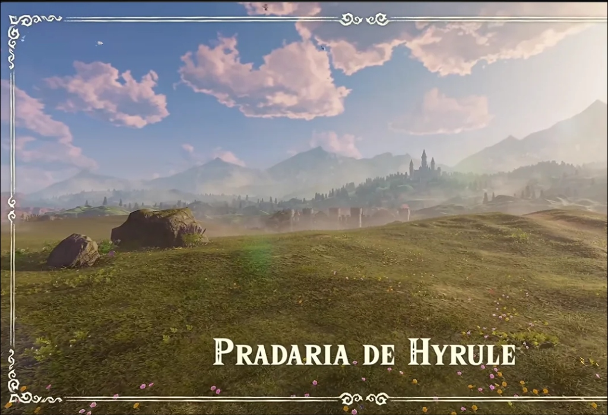
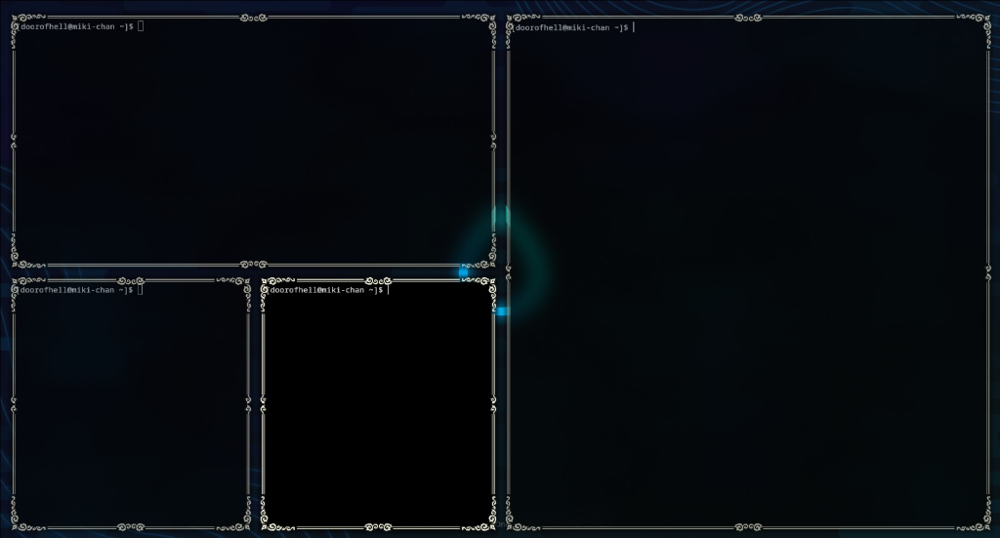
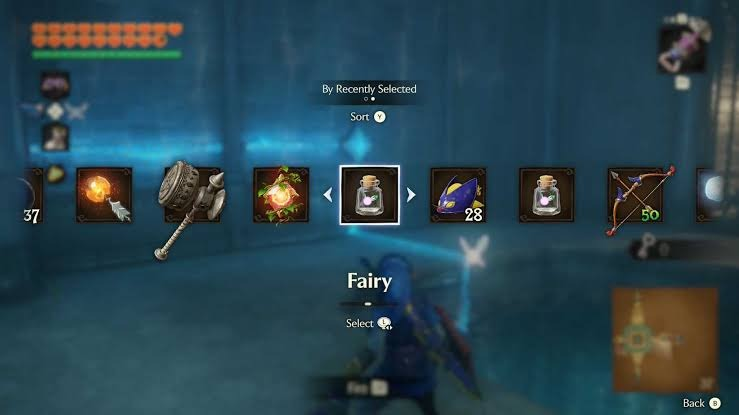
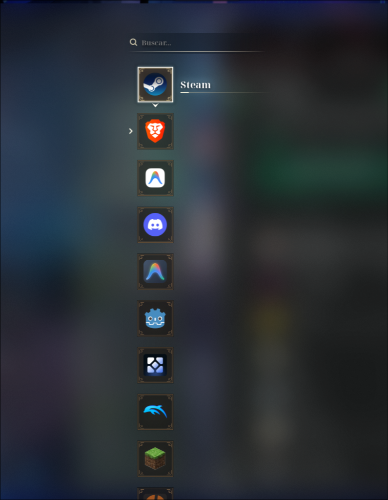
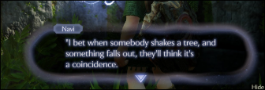
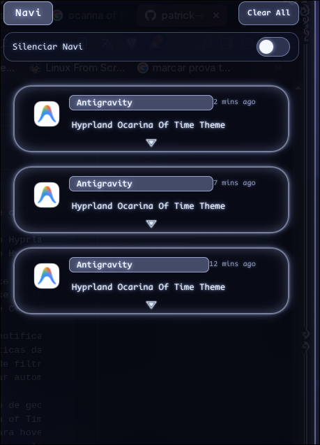
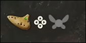
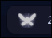
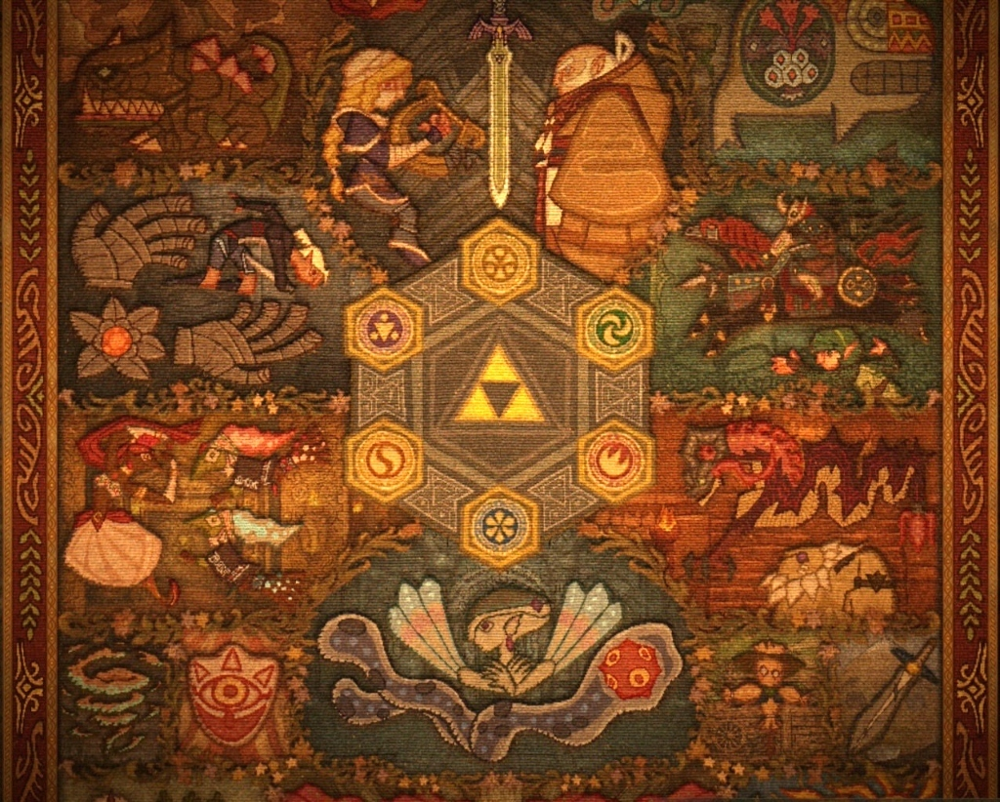
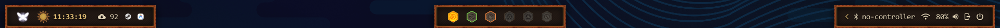

# 🗡️ The Legend of Zelda: Hypr of Time

> 🌐 **Language / Idioma:** **🇺🇸 English** | [🇧🇷 Português (Brasil)](README.pt-BR.md)

A complete **Hyprland**, **Wofi**, **SwayNC**, and **Waybar** rice inspired by the UI of **The Legend of Zelda: Ocarina of Time Remake** and **Breath of the Wild**.

---

## 🎨 Inspiration vs. Result

### 1. 🖼️ Ornate Window Borders (`Hyprland` + `imgborders`)

| 🎮 Inspiration (*Ocarina of Time Remake*) | ✨ Result (*Hyprland 9-Slice Borders*) |
| :---: | :---: |
|  |  |
| *Ornate region introduction frame with corner flourishes, double lines, and centered edge motifs.* | *Custom 9-slice border texture + patched `imgborders` plugin keeping the ornament centered on every window edge.* |

### 2. 🎒 Item Selection App Launcher (`Wofi`)

| 🎮 Inspiration (*Ocarina of Time Remake Item Screen*) | ✨ Result (*Wofi App Launcher*) |
| :---: | :---: |
|  |  |
| *Square item slots, glowing white selection border with directional chevrons, and external item label.* | *Vertical Wofi launcher with `72x72` ornate slots, `▲`/`▼` chevrons, external label + gold underline, mouse hover, and expandable sub-actions (`▸`).* |

### 3. 🧚‍♀️ Navi Dialogue Notifications (`SwayNC`)

| 🎮 Inspiration (*Ocarina of Time Remake*) | ✨ Result (*SwayNC Notification Center*) |
| :---: | :---: |
|  |  |
| *Original in-game Navi speech bubble with glowing stadium border, top-left name plate, and bottom blue arrow.* | *Custom SwayNC notification cards & control center matching the fairy dialogue aesthetic.* |

### 4. 🔔 Navi Status Indicator (`Waybar`)

| 🎮 Inspiration (*Ocarina of Time Remake HUD*) | ✨ Result (*Waybar Module*) |
| :---: | :---: |
|  |  |
| *In-game HUD fairy icon indicator.* | *Interactive Waybar module that glows and pulses on new notifications ("Hey! Listen!").* |

### 5. 📜 Zelda Tapestry & Sage Medallions Top Bar (`Waybar`)

| 🎮 Inspiration (*Ocarina of Time Tapestry & Sage Medallions*) | ✨ Result (*Waybar Tapestry Islands*) |
| :---: | :---: |
|  |  |
| *Ancient Hyrule tapestry featuring woven borders, the 6 Sage Medallions around the Triforce, and celestial motifs.* | *Three tapestry-framed islands (`tapestry-bg.png` + `tapestry-border.png`), the **6 Sage Medallions** as workspace indicators, and a dynamic **Sun's Song** time-of-day emblem.* |

---

## ✨ Features Included

### 1. 🖼️ Ornate 9-Slice Window Borders (`hypr/`)
- High-resolution 9-slice border textures (`zelda_border_ornate.png` and `zelda_border.png`) featuring symmetrical corner flourishes, seamless continuous ivory/aged-gold double lines, and **a single centered ornament** in the middle of each window edge.
- Custom patched [`imgborders`](hypr/plugins/imgborders/ImgBorder.cpp) Hyprland plugin with centered UV mapping (`0.5 - span * 0.5` to `0.5 + span * 0.5`) so the middle ornament stays perfectly centered on every window edge regardless of window dimensions.
- Includes both Hyprland Lua config (`hyprland.lua`) and classic config (`hyprland.conf`).

### 2. 🎒 Wofi App Launcher — *Ocarina of Time Remake Item Screen* (`wofi/`)
- Vertical column layout with a full-screen translucent backdrop and Hyprland layer `blur`.
- `72x72` dark-bronze/brown square item slots with corner curls (`slot_normal.png`).
- Bright glowing white frame on the selected item with vertical indicator chevrons (`▲` / `▼`), automatically hiding the top chevron on the first item (`slot_selected_first.png`) and the bottom chevron on the last item (`slot_selected_last.png`).
- App names are displayed **outside the square** (to the right, above an ornate gold/ivory underline) **only when the item is selected**.
- **Native Mouse Hover & Sub-Actions (`libwofi_hover.c`):**
  - Instant mouse-hover selection (`gtk_flow_box_select_child`) + single-click activation.
  - Clickable expander arrow (`▸`) to the left of multi-action apps (e.g., *New Window*, *New Incognito Window* on browsers).
  - Horizontal scroll lock (`GTK_POLICY_NEVER` + `hadjustment = 0`) so the icon column remains fixed at the exact center regardless of long `.desktop` app names or screenshot tools.

### 3. 🧚‍♀️ Navi Notification System (`swaync/` + `waybar/` + `hypr/scripts/`)
- **Navi Dialogue Box (`swaync/`):** Notifications styled after the *Ocarina of Time Remake* Navi speech bubble — deep midnight-blue translucent card, glowing fairy-blue stadium border, top-left speaker badge, and the signature glowing blue downward triangle (`navi-arrow.png`).
- **Interactive Waybar Indicator (`waybar/`):** Top-bar Navi sprite (`navi-idle.png`) that flashes and glows in alert mode (`navi-alert.png`) when unread notifications arrive or on hover.
- **Bilingual Navi Quotes (`navi_frases_en.txt` & `navi_frases.txt`):** On Hyprland startup (or anytime on demand), Navi greets you with *Ocarina of Time* + Linux/Hyprland tips in either **English** or **Portuguese**.

### 4. 📜 Zelda Tapestry & Sage Medallions Bar (`waybar/`)
- **Woven Tapestry Frame:** All three Waybar islands (`modules-left`, `modules-center`, `modules-right`) and tooltips use a tiled parchment/canvas background (`tapestry-bg.png`) and a 9-slice woven border (`tapestry-border.png`).
- **The 6 Sage Medallions as Workspaces (`hyprland/workspaces`):**
  - Workspace 1 — **Light Medallion** (`medallion-1-*`)
  - Workspace 2 — **Forest Medallion** (`medallion-2-*`)
  - Workspace 3 — **Fire Medallion** (`medallion-3-*`)
  - Workspace 4 — **Water Medallion** (`medallion-4-*`)
  - Workspace 5 — **Shadow Medallion** (`medallion-5-*`)
  - Workspace 6+ — **Spirit Medallion** (`medallion-6-*`)
  - Each medallion features distinct visual states for **empty** (carved stone slot), **inactive/occupied** (colored emblem), and **active/focused** (bright glowing medallion).
- **Dynamic *Sun's Song* Time-of-Day Emblem (`custom/sun-song` + `sun-song.sh`):** Displays a tapestry-styled celestial emblem next to the clock that automatically transitions across 6 phases of the day (`dawn`, `morning`, `day`, `afternoon`, `dusk`, `night`) with localized tooltips.

---

## 📦 Dependencies

On Arch Linux (and derivatives):

```bash
sudo pacman -S hyprland wofi swaync waybar libnotify socat python gcc pkgconf gtk3
```

*(Optional font used in the CSS stylesheets)*:
- `ttf-codenewroman-nerd` (AUR) or any Nerd Font of your choice.

---

## 🚀 Quick Installation

Clone the repository and run the automated installer (pass `--en` for English or `--pt` for Portuguese; if omitted, an interactive prompt lets you choose):

```bash
git clone https://github.com/patrick-e/The_Legend_Of_Zelda_Hypr_Of_Time.git
cd The_Legend_Of_Zelda_Hypr_Of_Time
chmod +x install.sh

# Install in English (EN):
./install.sh --en

# Or install in Portuguese (PT-BR):
./install.sh --pt
```

The installer automatically:
1. Replaces `__HOME__` placeholders with your `$HOME` path across all configs and stylesheets.
2. Backs up your existing `hyprland.lua` / `hyprland.conf` to `.pre-zelda.bak`.
3. Compiles the patched `libimgborders.so` Hyprland plugin and `libwofi_hover.so` GTK3 hook.
4. Configures Navi's quotes, Waybar tooltips, SwayNC labels, and Wofi search prompt in your chosen language (`EN` or `PT-BR`).

---

## 🎮 Keybindings & Usage

- **`SUPER + Space`** — Open the Wofi item/app menu (`LD_PRELOAD=~/.config/wofi/libwofi_hover.so wofi --show drun`).
- **`Arrow Keys ↑ / ↓` or `Mouse Hover`** — Navigate through items in Wofi.
- **`Tab` / `Right Arrow →` or click the `▸` arrow to the left of an icon** — Expand secondary launch actions for an app.
- **`Click Navi Icon (Waybar)`** — Toggle the Navi Notification Center (`swaync`).
- **`~/.config/hypr/scripts/navi-say.sh`** — Trigger a random Navi quote notification at any time.

---

## 📁 Repository Structure

```text
The_Legend_Of_Zelda_Hypr_Of_Time/
├── install.sh                       # Automated installer & compiler (--en / --pt)
├── README.md                        # English documentation
├── README.pt-BR.md                  # Portuguese (PT-BR) documentation
├── hypr/
│   ├── hyprland.lua                 # Hyprland configuration (Lua API)
│   ├── hyprland.conf                # Hyprland configuration (Standard conf)
│   ├── assets/
│   │   ├── zelda_border_ornate.png  # 9-slice border with centered edge ornaments
│   │   └── zelda_border.png         # Minimal 9-slice border (corners + double lines)
│   ├── plugins/imgborders/          # Patched C++ source for imgborders (centered UVs)
│   └── scripts/
│       ├── navi-say.sh              # Random Navi notification trigger (EN / PT-BR)
│       ├── navi_frases_en.txt       # Navi themed quotes (English)
│       ├── navi_frases.txt          # Navi themed quotes (Portuguese)
│       ├── hyprsunset-toggle.sh     # Blue-light shader toggle
│       └── waybar-fullscreen.sh     # Auto-hide Waybar on fullscreen windows
├── wofi/
│   ├── config                       # Wofi geometry & layout configuration
│   ├── style.css                    # Ocarina of Time Remake item screen stylesheet
│   ├── libwofi_hover.c              # GTK3 LD_PRELOAD hook for hover-select & scroll lock
│   └── assets/                      # Normal, selected, first/last slots & header textures
├── swaync/
│   ├── config.json                  # Navi dialogue notification configuration
│   ├── style.css                    # Ocarina of Time Remake speech bubble stylesheet
│   └── icons/                       # Bottom-center Navi dialogue arrow (SVG/PNG)
└── waybar/
    ├── config.jsonc                 # Top bar config with Navi custom/notification module
    ├── style.css                    # Navi idle/alert sprite transitions
    ├── icons/                       # Navi SVG/PNG sprites (idle & alert)
    └── scripts/                     # Real-time SwayNC listener & state emitter (EN / PT-BR)
```
